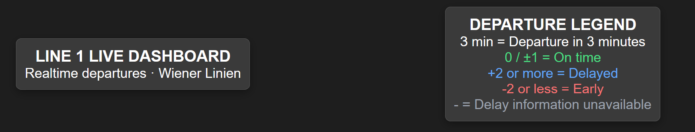
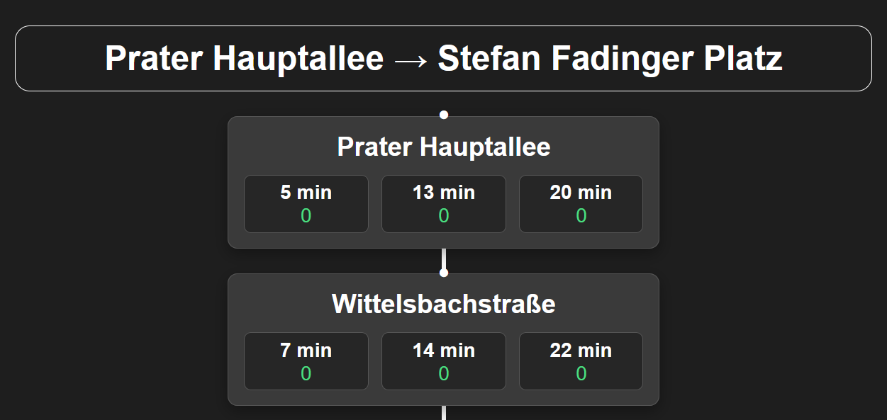

# Wiener Linien – Line 1 Live Dashboard

A responsive React dashboard displaying realtime departure information for Vienna's tram line 1 in both directions between Prater Hauptallee and Stefan-Fadinger-Platz.

The application retrieves data from the Wiener Linien Open Government Data (OGD) API and automatically refreshes departure information every 30 seconds.

## Screenshots

### Dashboard and departure legend



### Departure cards



## Features

- Displays both directions of tram line 1 with stops in route order
- Shows up to three upcoming departures per stop
- Displays departure countdowns in minutes
- Colour-coded delay indicators for on-time, delayed and early departures
- Automatically refreshes data every 30 seconds
- Responsive two-column desktop and single-column mobile layout
- Initial loading indicator and HTTP/network error handling
- Distinguishes unavailable realtime data from empty departure lists
- Hides outdated departure information when API requests fail
- Displays a service notice explaining temporary route limitations

## Technologies

- **React** – Component-based user interface
- **JavaScript** – Data processing and application logic
- **CSS** – Styling and responsive layouts
- **Vite** – Development tooling and API proxy
- **Wiener Linien OGD API** – Realtime public transport data

## Getting Started

### Requirements

- Node.js compatible with the project's Vite version
- npm
- Internet connection for realtime API requests

### Installation

Clone the repository:

```bash
git clone https://github.com/Nexay-021/wiener-linien-dashboard.git
cd wiener-linien-dashboard
```

Install dependencies:

```bash
npm ci
```

Start the development server:

```bash
npm run dev
```

Open the local URL displayed in the terminal.

### Available Commands

| Command           | Description                            |
| ----------------- | -------------------------------------- |
| `npm run dev`     | Start the Vite development server      |
| `npm run build`   | Generate an optimized production build |
| `npm run preview` | Preview the production build locally   |
| `npm run lint`    | Run ESLint checks                      |

## How It Works

### Route Configuration

Stop names and RBL identifiers for both directions are defined in `src/data/line1Route.js`.

The route configuration was prepared using Wiener Linien's published CSV datasets. These source files are not required to run the application and are excluded from the repository.

The dashboard currently uses a predefined route rather than dynamically reconstructing routes during service disruptions.

### Realtime Departures

The application collects the configured stop IDs and sends them as query parameters to the Wiener Linien realtime API.

The response is processed to:

1. Identify the returned stop information.
2. Select departures belonging to tram line 1.
3. Skip monitors belonging to unrelated lines.
4. Filter departures with valid countdown values.
5. Extract up to three upcoming departures per stop.
6. Store the processed data by stop ID for rendering.

React components then display the information for each station and direction.

### Delay Indicators

Delay is calculated from the difference between the planned and realtime departure timestamps, rounded upward to whole minutes.

| Displayed delay    | Status                        |
| ------------------ | ----------------------------- |
| −1 to +1 minutes   | On time                       |
| +2 minutes or more | Delayed                       |
| −2 minutes or less | Early                         |
| `-`                | Delay information unavailable |

These classifications are presentation rules defined for this project.

### Missing Data and Error Handling

The dashboard distinguishes between several situations:

| Situation                        | Application behaviour                               |
| -------------------------------- | --------------------------------------------------- |
| Valid departure data             | Displays countdowns and delay indicators            |
| Empty usable departure list      | Shows "No upcoming departures reported"             |
| Missing Line 1 data for a stop   | Shows "No realtime data available"                  |
| HTTP or network failure          | Displays an error message and hides departure cards |
| Successful request after failure | Restores departure information automatically        |

HTTP errors include the status code and available status description.

Missing data does not necessarily indicate a service disruption. It can also occur when the API does not provide usable departure information for a requested stop.

## API Routing and Hosting

During local development, Vite uses a proxy to forward requests beginning with `/api` to the Wiener Linien API at `https://www.wienerlinien.at`, removing the `/api` prefix.

For example:

```text
/api/ogd_realtime/monitor?stopId=171
```

is forwarded to:

```text
https://www.wienerlinien.at/ogd_realtime/monitor?stopId=171
```

The development proxy is not included in Vite's generated production files.

A hosted version would therefore require equivalent server-side routing or a backend proxy to access the realtime API.

**This repository is intended primarily as a locally run portfolio and learning project.** Production deployment is not currently configured.

## Known Limitations

- Only tram line 1 is supported.
- The displayed stop order follows a predefined route.
- Temporary diversions are not automatically reflected in the route configuration.
- Stops affected by service changes may have unavailable departure data.
- Realtime information depends on the availability and accuracy of the Wiener Linien API.
- Data refreshes every 30 seconds rather than continuously.
- Delay values are rounded upward to whole minutes.
- The application is not an official Wiener Linien product.

## Possible Future Improvements

- Display the timestamp of the last successful data update
- Support additional tram and public transport lines
- Integrate service disruption information from the API
- Dynamically adapt stop lists during temporary route diversions
- Add line selection, filtering and additional visualisations

## Project Background

This project was developed to practise React, JavaScript, asynchronous API integration, data processing, error handling and responsive frontend development.

It also provided practical experience with debugging realtime API responses, managing Git branches and improving application reliability.

AI tools were used for technical guidance, debugging and assistance with parts of the implementation.

## Data Source

Realtime departure information and the original route datasets are provided by **Wiener Linien Open Government Data (OGD)**.

This is an independent educational project and is not affiliated with or endorsed by Wiener Linien.
